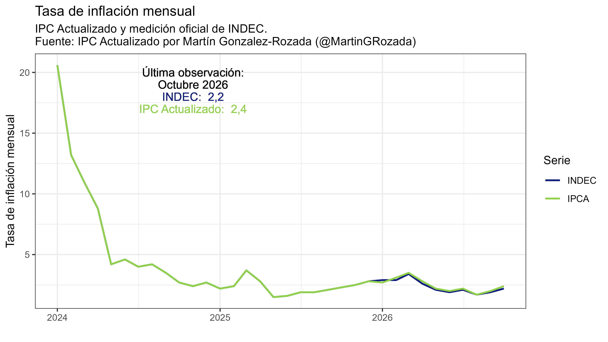

## RESULTADOS OCTUBRE 2026

El nivel general del Índice de Precios al Consumidor Actualizado (IPCA) aumentó un 2.4 por ciento en octubre, luego de haber aumentado un 2.0 por ciento en septiembre impulsado por el aumento de precios de las divisiones de Vivienda, agua, electricidad, gas y otros combustibles y Alimentos y bebidas no alcohólicas, que explicaron alrededor del 30.0 y 18.0 por ciento de la inflación respectivamente (Cuadros 1 y 2). En comparación, la tasa de inflación mensual oficial publicada por el INDEC fue de 2.2 por ciento (Figura 1).

Durante los últimos 12 meses, la inflación interanual fue de 34.3 por ciento, comparado con el valor de 33.1 por ciento en los datos oficiales (Cuadro 1). 

***Para leer el informe completo, haga click [aquí](https://mrozada.github.io/inflacionlatente/).***

***Links a informes en PDF***

[Octubre 2026](https://github.com/mrozada/mrozada.github.io/blob/master/assets/pdf/inflacion_actualizada_octubre2026.pdf)

[Septiembre 2026](https://github.com/mrozada/mrozada.github.io/blob/master/assets/pdf/inflacion_actualizada_septiembre2026.pdf)

[Agosto 2026](https://github.com/mrozada/mrozada.github.io/blob/master/assets/pdf/inflacion_actualizada_agosto2026.pdf)

[Julio 2026](https://github.com/mrozada/mrozada.github.io/blob/master/assets/pdf/inflacion_actualizada_julio2026.pdf)

[Junio 2026](https://github.com/mrozada/mrozada.github.io/blob/master/assets/pdf/inflacion_actualizada_junio2026.pdf)

[Mayo 2026](https://github.com/mrozada/mrozada.github.io/blob/master/assets/pdf/inflacion_actualizada_mayo2026.pdf)

[Abril 2026](https://github.com/mrozada/mrozada.github.io/blob/master/assets/pdf/INFLACION%20ACTUALIZADA%20-%202026-04.pdf)

[Marzo 2026](https://github.com/mrozada/mrozada.github.io/blob/master/assets/pdf/INFLACION%20ACTUALIZADA%20-%202026-03.pdf)

[Febrero 2026](https://github.com/mrozada/mrozada.github.io/blob/master/assets/pdf/INFLACION%20ACTUALIZADA%20-%202026-02.pdf)

[Enero 2026](https://github.com/mrozada/mrozada.github.io/blob/master/assets/pdf/INFLACION%20ACTUALIZADA%20-%202026-01.pdf)

[Diciembre 2025](https://github.com/mrozada/mrozada.github.io/blob/master/assets/pdf/INFLACION%20LATENTE%20-%202025-12.pdf)

[Noviembre 2025](https://github.com/mrozada/mrozada.github.io/blob/master/assets/pdf/INFLACION%20LATENTE%20-%202025-11.pdf)

[Octubre 2025](https://github.com/mrozada/mrozada.github.io/blob/master/assets/pdf/INFLACION%20LATENTE%20-%202025-10.pdf)

[Septiembre 2025](https://github.com/mrozada/mrozada.github.io/blob/master/assets/pdf/INFLACION%20LATENTE%20-%202025-09.pdf)

[Agosto 2025](https://github.com/mrozada/mrozada.github.io/blob/master/assets/pdf/INFLACION%20LATENTE%20-%202025-08.pdf)

[Julio 2025](https://github.com/mrozada/mrozada.github.io/blob/master/assets/pdf/INFLACION%20LATENTE%20-%202025-07.pdf)

[Junio 2025](https://github.com/mrozada/mrozada.github.io/blob/master/assets/pdf/INFLACION%20LATENTE%20-%202025-06.pdf)

[Mayo 2025](https://github.com/mrozada/mrozada.github.io/blob/master/assets/pdf/INFLACION%20LATENTE%20-%202025-05.pdf)

[Abril 2025](https://github.com/mrozada/mrozada.github.io/blob/master/assets/pdf/INFLACION%20LATENTE%20-%202025-04.pdf)

[Marzo 2025](https://github.com/mrozada/mrozada.github.io/blob/master/assets/pdf/INFLACION%20LATENTE%20-%202025-03.pdf)

[Febrero 2025](https://github.com/mrozada/mrozada.github.io/blob/master/assets/pdf/INFLACION%20LATENTE%20-%202025-02.pdf)

[Enero 2025](https://github.com/mrozada/mrozada.github.io/blob/master/assets/pdf/INFLACION%20LATENTE%20-%202025-01.pdf)

